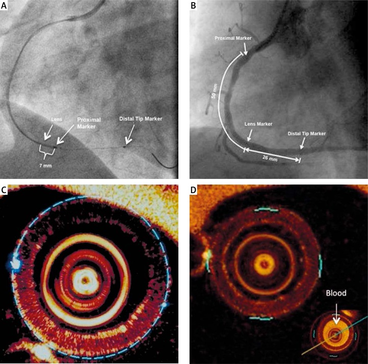
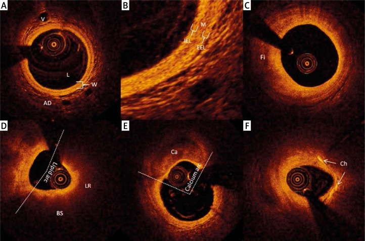
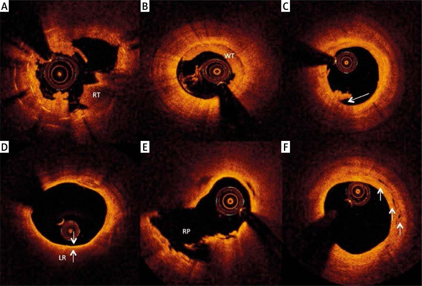
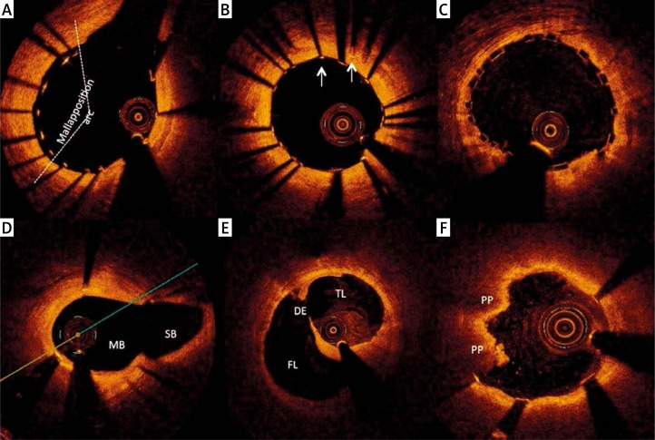
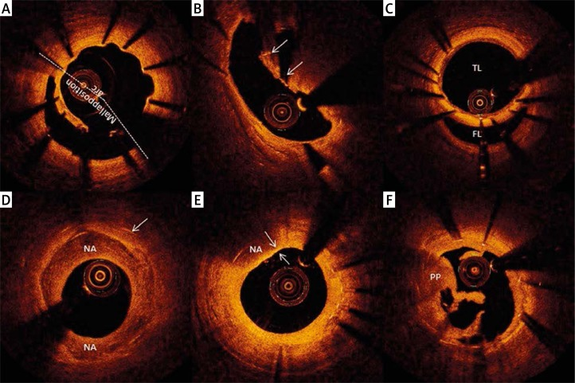

# The basics of intravascular optical coherence tomography

**Authors:** Tomasz Roleder, Jacek Jąkała, Grzegorz L Kałuża, Łukasz Partyka, Klaudia Proniewska, Elżbieta Pociask, Wojciech Zasada, Wojciech Wojakowski, Zbigniew Gąsior, Dariusz Dudek

*Postepy Kardiol Interwencyjnej. 2015 Jun 20;11(2):74–83. doi: [10.5114/pwki.2015.52278](https://doi.org/10.5114/pwki.2015.52278)*

## Abstract

Optical coherence tomography (OCT) has opened new horizons for intravascular coronary imaging. It utilizes near-infrared light to provide a microscopic insight into the pathology of coronary arteries *in vivo*. Optical coherence tomography is also capable of identifying the chemical composition of atherosclerotic plaques and detecting traits of their vulnerability. At present it is the only tool to measure the thickness of the fibrous cap covering the lipid core of the atheroma, and thus it is an exceptional modality to detect plaques that are prone to rupture (thin fibrous cap atheromas). Moreover, it facilitates distinguishing between plaque rupture and plaque erosion as a cause of acute intracoronary thrombosis. Optical coherence tomography is applied to guide angioplasties of coronary lesions and to assess outcomes of percutaneous coronary interventions broadly. It identifies stent malapposition, dissections, and thrombosis with unprecedented precision. Furthermore, OCT helps to monitor vessel healing after stenting. It evaluates the coverage of stent struts by the neointima and detects in-stent neoatherosclerosis. With so much potential, new studies are warranted to determine OCT's clinical impact. The following review presents the technical background, basics of OCT image interpretation, and practical tips for adequate OCT imaging, and outlines its established and potential clinical application.

**Keywords:** optical coherence tomography, stent, atherosclerosis

## Introduction

Optical coherence tomography (OCT) is the latest development in intravascular coronary imaging. Similarly to intravascular ultrasound (IVUS), OCT provides cross-sectional images of the vessel. However, instead of sound, OCT employs light for tissue analysis that enables visualization of the coronary lesions with almost microscopic precision \[1, 2\]. Optical coherence tomography was developed by Huang *et al*. at the Massachusetts Institute of Technology. They first demonstrated *ex vivo* imaging of the retina and atherosclerotic plaque in 1991 \[3\]. Brezinski *et al*. were the first to suggest intravascular application of OCT. In an *ex vivo* study \[4\] they confirmed the ability of OCT to detect with sufficient resolution intimal cap layers associated with unstable plaque. Subsequently they developed a fiberoptic-based catheter that was first used in animals \[4\].

High-resolution images of OCT allow identification of the morphology of atherosclerotic plaque and have the potential to detect its chemical composition \[5\]. Moreover, OCT is uniquely capable of guiding percutaneous coronary interventions (PCI) and assessing their outcomes \[6\]. As recently reported, OCT-guided PCI brought benefit for patients’ treatment as compared to PCI guided by angiography alone \[7\]. However, to benefit the most from OCT imaging, it is essential to understand the principles of OCT, to develop an appropriate technique of imaging, and to become familiar with the basics of image interpretation.

## Principles of optical coherence tomography

Optical coherence tomography is a near-infrared (nIR) light based imaging modality whose central wavelength of light ranges from 1250 to 1350 nm. It measures an interference signal of the nIR light backscattered from the analyzed tissue with the light backscattered from the reference mirror. The frequency of the interference signal corresponds to the depth of the analyzed tissue. There are two approaches to analyze the interference signal of nIR: a time-domain (TD) slow analysis and a frequency-domain (FD) fast analysis. Time-domain analysis measures the alteration of the interference signal derived by one wavelength of nIR light at a time. Conversely, FD analysis using Fourier transformation measures the interference signal of the whole spectrum of nIR light at a single time point \[2\]. Introduction of FD analysis was a key milestone toward clinical viability of intravascular OCT as it significantly decreased the time of OCT imaging and eliminated the need to temporarily occlude the investigated segment in order to clear it from the blood. Therefore, current systems of intravascular OCT imaging employ only FD analysis.

The OCT probe is composed of a signal generator (light source) (“swept laser”), a detector and a reference fixed mirror. nIR light travels from the light source to the probe via an optical fiber, and the probe directs the light outwards and perpendicular to the catheter. The probe rotates with the frequency of 100 rounds/s, which allows acquisition of 50 000 axial lines of the signal/s.

The use of light enables OCT to provide high-resolution images (10–20 µm) of the vessel wall as compared to images obtained by IVUS (100 µm). Nevertheless, the use of light generates particular limitations in its application to intravascular imaging. The blood cells cause multiple scattering of nIR light and its high signal attenuation; as a consequence OCT imaging technique requires blood removal out of the vessel during imaging. In addition, nIR light has limited penetration into the vessel wall and obtains a signal only from 1 to 3 mm in depth. Such a low penetration of the light beam hampers a full assessment of the plaque. In contrast, IVUS is able to penetrate up to 8 mm deep into the tissue \[8\].

## Technique of optical coherence tomography imaging

The OCT system consists of three elements: an intracoronary OCT catheter, a dock, and a console to acquire and review images and perform measurements. An offline workstation for image analysis may also be available.

At present, all available systems require at least a 6 Fr size guiding catheter to advance the OCT catheter into the coronary artery. The guiding catheter used for OCT imaging should not contain side holes and should provide a stable support.

The OCT catheter contains a rotating probe inside to emit nIR light and detect the backscattered light. Like most contemporary coronary equipment, the OCT catheter is a rapid exchange delivery system, which is advanced into the coronary artery over a standard coronary guidewire (0.014”). There are two types of OCT catheters: the Dragonfly Intravascular Imaging Catheter and the Dragonfly Duo OCT Imaging Catheter. There are two radiopaque markers at the tip of the Dragonfly Intravascular Imaging Catheter and the probe placed 7 mm proximally to the proximal one, and there are three radiopaque markers at the tip of the Dragonfly Duo Intravascular Imaging Catheter, of which the middle one is the probe (Figure 1).

**Figure 1.** Positioning of the OCT catheter and calibration of the system. Location of the lens in relation to proximal marker (PM) and distal marker (DM) under fluoroscopy for (**A**) Dragonfly Intravascular Imaging Catheter and for (**B**) Dragonfly Duo OCT Imaging Catheter. **C** – Perfect Z-offset to obtain accurate measurements – the blue line should be positioned at the edges of the catheter. **D** – No blood inside the OCT catheter. In the lower right corner the insert illustrates blood appearance inside the catheter

The OCT catheter is connected to the OCT console by the dock, and the dock operates an automatic pullback of the probe inside the catheter. A single pullback is performed with a speed of 20 mm/s and lasts 2.7 s. It allows imaging of up to 72 mm of the vessel during a single run of the probe. Such a fast pullback of the OCT probe significantly reduces the bias caused by cardiac movement.

The OCT imaging requires blood removal from the vessel at the time of the pullback. Therefore, the previous generation of TD-based OCT imaging required occlusion of the vessel at the time of imaging, which increased the risk of ventricular fibrillation. The new FD-based OCT imaging does not require occlusion of the vessel anymore, and thus the risk of life-threatening arrhythmias is significantly reduced \[1\]. The blood inflow into the vessel is sufficiently restricted by the contrast injection into the artery at the time of the pullback. The contrast may be injected either manually or using an automatic injector. The setting for the automatic injection is as follows: flow speed = 4 ml/s, volume = 14 ml, pressure = 400 PSI and rise time = 0s. It is also important to flush the blood away from the OCT catheter before the pullback of the probe starts; a small syringe filled with contrast is used for that. The presence of blood in the OCT catheter or in the lumen of the vessel disqualifies acquired images from the analysis (Figure 1).

The pullback of the OCT probe starts automatically following the contrast injection. When the pullback is finished, the OCT probe returns to its initial position and the catheter may be removed from the vessel. Due to the ultrafast OCT catheter's pullback, all acquired images are reviewed and analyzed off-line.

## Image analysis

### Normal coronary artery morphology

In a healthy vessel OCT visualizes three layers of the artery: an internal elastic lamina (an abluminal bright, high reflective line), a media (a dark, low-reflective line) and an external elastic lamina (an adluminal high reflective zone). Beyond the external elastic lamina, OCT exposes an adventitia with its vasa vasorum (Figure 2).

**Figure 2.** Representative OCT images of a healthy vessel and fibrotic, calcified, lipid-rich and thin fibrous cap atheroma. **A** – Healthy vessel: lumen (L), vessel wall (W), and adventitia (AD) with vasa vasorum (V). **B** – Three layers of the vessel: internal elastic lamina (IEL), media (M) and external elastic lamina (EEL). **C** – Fibrotic atheroma (Fi). **D** – Lipid-rich plaque (LR) with lipid arc = 190° and bright spots (BS). **E** – Calcified atheroma (Ca) with calcium arc = 93°. **F** – Lipid-rich plaque with cholesterol clefts (Ch)

### Atherosclerosis

The OCT imaging offers a possibility to distinguish lipid-rich, calcified and fibrotic lesions. The analysis of the plaque composition is based on its homogeneity, reflectivity and demarcation from other structures. Lipid deposition is characterized by diffuse edges with high reflectivity and high attenuation. Calcium features sharp edges with low reflectivity and low attenuation. Fibrotic components of the plaque are visualized as a homogeneous, low-attenuated zone with high reflectivity. It is also possible to detect cholesterol clefts in the vessel as irregular bright zones. Interestingly, some histological studies indicated that bright spots with high reflectivity and uneven shadowing might represent the agglomeration of macrophages in the vessel wall (Figure 2) \[9\].

In addition to the analysis of the plaque composition, OCT is also able to detect white and red thrombus inside the arterial lumen. The white thrombus appears as an irregular structure of high reflectivity and low attenuation of the signal, and the red thrombus is shown as an irregular structure of low reflectivity and high attenuation of the signal (Figure 3).

**Figure 3.** Thrombus and structures within the plaque by OCT. **A** – Red thrombus (RT). **B** – White thrombus (WT). **C** – Thrombus inside the vessel without ruptured plaque, which suggests plaque erosion. **D** – Thin fibrous cap (40 µm, white arrows) covers the lipid-rich core (LR) (TCFA – thin cap fibrous atheroma). **E** – A ruptured lipid-rich plaque (RP). **F** – Neovascularization of the plaque (white arrows indicate small vessels)

### Quantitative assessment of the lesion

Optical coherence tomography images demarcate the lumen of the vessel clearly. Thus, the incorporated algorithm allows fast semi-automatic measurement of its diameter and area. As compared to IVUS, OCT provides a smaller area and a shorter diameter of the artery lumen. The difference falls in a range between 10% and 20% \[10, 11\]. In addition, an autopsy study demonstrated that OCT measurements correlate well with those obtained by histopathology, and that OCT estimates of the size of the vessel lumen are closer to those obtained from histopathology than IVUS-derived measurements: 28% vs. 40% respectively \[12\]. It should be noted that perfect calibration of the OCT system is required to obtain reliable measurements, which is based on the size of the OCT probe (Z-offset) (Figure 1).

The assessment of the artery at its proximal or distal reference segment helps to estimate the length of the lesion and its percentage stenosis. However, OCT provides only the geometric assessment of the disease and cannot be used to determine the functional significance of a stenosis. A study which compared OCT results against values of the fractional flow reserve suggested that a lumen area of less then 1.9 mm² correlated with significant myocardial ischemia \[13\].

Unfortunately, the limited penetration into the vessel wall hinders quantification of the plaque burden (the proportion of a plaque that occupies the vessel). However, the transverse extent of either the lipid core or the calcium core in the vessel can serve as a surrogate for the plaque burden. They are expressed in degrees and termed as the lipid arc or calcium arc respectively (Figure 2).

### Vulnerable plaque detection

Optical coherence tomography is now a gold standard to detect vulnerable plaques that are prone to rupture. Such plaques present with the following features: a thin fibrous cap (\< 65 µm), a lipid rich core, neovascularization, and macrophage infiltration \[14, 15\]. All these features are reliably detectable by OCT, and especially the precise measurement of the thin fibrous cap is now possible due to OCT's superior resolution (Figure 3) \[5, 16, 17\].

## Clinical applications

### Stent size selection

Optical coherence tomography measurements of the vessel lumen facilitate selection of the appropriate stent diameter and length required for PCI. Two techniques have been reported to obtain a reference for stent diameter by OCT, which are similar to IVUS guidance: one refers to the average “media to media” diameter and the other to the average diameter of the lumen. So far, there have been no reports of long-term outcomes that would clearly demonstrate whether either of these approaches is superior.

### Strategy for calcified lesions

The OCT-derived morphology of the plaque may help to select the best strategy for PCI. As it was reported by IVUS studies, almost 65% of calcified lesions cannot be detected by angiography alone \[18\]. Since OCT is able to detect a calcified lesion with the same accuracy as IVUS \[19\], its results may serve as an indication for the use of a high-pressure balloon or rotablation to facilitate PCI of calcified lesions.

### Prediction of peri-procedural complications

The prediction of peri-procedural complications may help increase patients’ safety and decrease costs of the procedure and the time of hospitalization. Previous reports stated that OCT-detected thin cap fibrous atheroma (TCFA) was a predictor of the no-reflow phenomenon and a peri-procedural myocardial infarction \[20, 21\]. The reported prevalence of microvascular obstruction and the no-reflow phenomenon was directly proportional to the size of the lipid arc and inversely related to fibrous cap thickness \[22\].

Furthermore, OCT imaging may monitor the optimal elimination of thrombus out of the infarct-related artery, and also facilitates identification of the plaque rupture responsible for ST-segment elevation myocardial infarction (STEMI). The presence of the thrombus in the lumen and the rupture plaque is a risk factor of the no-reflow phenomenon as well (Figure 3) \[23\].

### Treatment of eroded plaques

Previous histological studies have reported that eroded (not ruptured) plaques cause almost 40% of STEMI \[15\]. Those eroded plaques are mostly fibrotic ones with endothelial denudation on their surface. Interestingly, most eroded plaques are neither lumen-narrowing nor lipid-rich ones, and thus they may be treated without stent placement.

Optical coherence tomography imaging is able to differentiate between plaque rupture and plaque erosion as the cause of intravascular thrombogenesis. Therefore, OCT-diagnosed plaque erosion may suggest performing only thrombectomy without stenting in the infarct-related artery. It is a novel concept of STEMI treatment, but the results from a small group of patients are promising. The patients with OCT-diagnosed eroded plaque and subjected only to thrombectomy without stenting did not report any major adverse cardiac events during median 735 days follow-up (Figure 3) \[24\]. Whether the OCT-guided reduction of stent use may translate into reduction of plaque/thrombus disruption and subsequent microembolization/no-reflow remains to be elucidated.

### Imaging of percutaneous coronary intervention outcomes

Optical coherence tomography is irreplaceable in terms of immediate and long-term analysis of PCI outcomes. Due to its high resolution it enables unparalleled insight into stent apposition and its expansion. It also detects, with unprecedented precision, the stent edge dissections, protrusion of the plaque through struts and in-stent thrombosis.

Stent struts are defined as well embedded in the vessel wall, protruding to the lumen out of the vessel wall, or malapposed when stent struts do not touch the vessel wall. Since OCT is only available to detect the adluminal edge of struts, the diagnosis of stent malapposition is based on the distance between the adluminal edge of the stent strut and the vessel wall. If the distance between the edge of the strut and the vessel wall is more than the thickness of the strut for bare metal stents (BMS) or if it is more than the total thickness of the strut plus the thickness of the polymer for drug-eluting stents (DES), it indicates malapposition. A distance longer than 160 µm suggests malapposition for most stents.

The extent of the malposition is defined by its arc (similar to a lipid arc) and by its length (Figure 4). Small malappositions are covered by the neointima and do not require any correction \[25\]. However, a significant malapposition (\> 200 µm) is a risk factor of acute in-stent thrombosis (Figure 4) \[26, 27\].

**Figure 4.** Post-procedure outcomes of percutaneous coronary intervention by OCT. **A** – Malapposition of stent struts (malapposition arc = 65°). **B** – The stent in the previously implanted stent. **C** – The bioabsorbable stent scaffold. **D** – Coronary bifurcation (MB – main branch, SB – side branch). **E** – Coronary artery's dissection with visible true (TL) and false vessel lumen (FL), and the entry of the dissection (DE). **F** – Plaque protrusion (PP) after stent implantation

Early after stent implantation, OCT is also able to detect the plaque protrusion through stent struts. It features a smooth surface with high signal attenuation (Figure 4). Tissue protrusion is mostly observed in the lesion responsible for acute coronary syndromes because such lesions are replete with lipid \[28\]. It has been documented to be an independent predictor of peri-procedural myocardial infarction \[21\].

Furthermore, unlike IVUS and angiography, OCT is very sensitive to detect dissection of the vessel \[29\]. Preliminary observation indicated that dissections which are not lumen-narrowing, are limited to intima, and are less than 2.5 mm long may be left untreated (Figure 4) \[29\].

### Follow-up of percutaneous coronary intervention outcomes

Optical coherence tomography reveals the coverage of stent struts by the neointima and detects uncovered stent struts \[30\]. The OCT-derived area of the neointima correlates very well with the histology, with values only about 6.3% smaller \[31\]. Uncovered stent struts are also a strong risk factor of in-stent thrombosis (Figure 4) \[32\].

Moreover, OCT not only precisely quantifies the neointima over the stent struts but also provides insights into its composition. The analysis of the neointima's composition may reveal deposition of lipids, which indicates in-stent neoatherosclerosis \[33\]. In-stent neoatherosclerosis occurs in both DES and BMS and may also present as TCFA \[34\]. Such neoatheromas, like typical atheromas, may rupture and cause acute in-stent thrombosis. Interestingly, recent OCT studies demonstrate that some neoatheromas evolve into calcifications located inside of the stent (Figure 5) \[35\].

**Figure 5.** Late outcomes of percutaneous coronary intervention by OCT. **A** – Covered struts in malapposition. **B** – Underexpansion of the stent. **C** – Chronic vessel dissection; true lumen (TL), false lumen (FL). **D** – Heterogeneous neointima in the stent (arrow indicates stent strut). **E** – Thin fibrous cap covering neoatheroma (50 µm); **F** – Plaque protrusion after balloon angioplasty in the restenotic stent

### Imaging of bioabsorbable vascular scaffolds

Bioresorbable vascular scaffolds (BVS) are not radiopaque and their assessment is limited under fluoroscopy after the implantation. Fortunately, nIR light backscatters from the implanted BVS and thus OCT presents with histology-like precision in its entire footprint (as opposed to only linear reflection of the adluminal surface of the metallic stent struts (Figure 4 C vs. 4 B), apposition and its expansion \[36\]. Moreover, it can monitor vessel healing and absorption after implantation \[37\]. Progress in absorption of the scaffold is much better visible in OCT than in IVUS \[38\].

### Guidance for percutaneous coronary intervention of bifurcations

Optical coherence tomography is also used to guide bifurcation stenting. The benefit of OCT is to image the position of the guidewire, which is advanced through stent struts into the side branch \[39\]. It is best visualized by the three dimensional reconstruction of OCT images, which is still investigational \[40\]. If the guidewire is positioned close to the carina, the best apposition of stent struts is achieved by the “kissing balloon” technique.

After the bifurcation stenting, OCT presents the shape of the carina and detects the malapposition of stent struts. Note that PCI of bifurcations is an independent risk of malapposition and in-stent thrombosis; hence the precise guidance by OCT can reduce the risk (Figure 5) \[41\].

### Identification of transplant vasculopathy

The prevalence of coronary vasculopathy (CAV) is almost 50% after heart transplantation in the 5-year follow-up. Due to denervation of the transplanted heart, anginal symptoms of CAV are not obvious and the care of patients after the heart transplant has to be extremely vigilant. Therefore, coronary angiography is repeated annually to screen for CAV. Nevertheless, angiography alone is limited to detect such vasculopathy because CAV is usually diffused across coronary arteries and may not manifest under fluoroscopy as obstructive disease, while in fact causing coronary flow impairment and ischemia.

Due to its superior resolution, OCT features higher sensitivity in detection of CAV as compared to angiography and allows quantification of intimal and medial thickening. Moreover, it is able to map lipid deposits in coronary arteries of the transplanted heart \[42\]. However, future studies are warranted to determine the predictive clinical value of that OCT-derived information. If OCT detects lipid-rich plaques in CAV, it may be used to stratify patients to aggressive lipid-lowering therapy in order to prevent silent coronary disease syndromes \[43\].

### Optical coherence tomography in extracoronary vasculature

Although OCT has been primarily used in coronary vasculature, reports are available for other vascular beds too. Yoshimura *et al*. \[44\] studied a population of patients with carotid artery stenosis and compared OCT vs. IVUS results in these vessels \[45\].

Similarly, OCT was used for evaluation of lower limb vessels – both femoro-popliteal \[46\] and below-the-knee \[47\] arteries. Other applications include imaging of radial arteries \[48\] and visualization of intimal thickening of pulmonary arteries in patients with pulmonary hypertension \[49\].

## Limitations of optical coherence tomography

First of all, an additional volume of contrast is unavoidable for OCT imaging, and hence it should be applied in patients with renal insufficiency carefully. Secondly, effective contrast injection requires the guiding catheter to intubate the coronary ostium, and that limits the analysis of ostial lesions. Thirdly, OCT image analysis is not free from artifacts, and therefore its results depend strongly on the observer's experience. Finally, limited nIR light penetration depth hinders OCT application in vessels of more than 10 mm in diameter and impedes the comprehensive analysis of the plaque burden in the presence of significant positive remodeling where the external elastic lamina is quite remote from the lumen edge.

## Pros and cons of optical coherence tomography as compared to intravascular ultrasound

Still, there is a lively discussion between proponents and opponents of these two intravascular methods. Advantages of OCT are its high resolution, fast pullback of the OCT probe, the high accuracy of the plaque composition assessments \[5\] and the impressive assessment of implanted stents. However, its disadvantages are the additional contrast injection, the lack of ostial lesion imaging, and low tissue penetration that impedes the quantification of plaque burden. These limitations may be overcome by IVUS that complements OCT imaging, and technology development is underway to develop hybrid systems combining both modalities in one catheter. Despite low image resolution, IVUS penetrates deeper into the vessel wall and enables quantification of the plaque burden in a broader range of vessel calibers. Moreover, IVUS imaging does not require additional contrast injection and thus is friendlier logistically and in the setting of renal compromise, as well as more suitable for the assessment of ostial lesions. Nevertheless, low resolution of IVUS imaging does not match the OCT capability to measure the thickness of the fibrous cap covering the lipid core, neointimal stent strut coverage or to detect luminal dissections and thrombus. Although radio-frequency analysis of the IVUS signal claims to be able to characterize plaque composition, its accuracy is controversial \[50\].

## Conclusions

Optical coherence tomography provides a new insight into the pathology of coronary artery disease *in vivo* and is irreplaceable to assess the immediate and long-term outcomes of PCI. It is broadly applied to assess the vessel healing after stent implantation. Moreover, in the near future, it may change the strategy of interventions for eroded plaque and improve the follow-up of patients after heart transplantation. With so much diverse information provided by OCT, further studies are warranted to determine its long-term clinical impact and predictive value in patients with atherosclerotic disease.

## Conflict of interest

The authors declare no conflict of interest.

## References

1. Yamaguchi T, Terashima M, Akasaka T, et al. Safety and feasibility of an intravascular optical coherence tomography image wire system in the clinical setting. Am J Cardiol. 2008;101:562–7. doi: 10.1016/j.amjcard.2007.09.116.
2. Choma M, Sarunic M, Yang C, Izatt J. Sensitivity advantage of swept source and Fourier domain optical coherence tomography. Opt Express. 2003;11:2183–9. doi: 10.1364/oe.11.002183.
3. Huang D, Swanson EA, Lin CP, et al. Optical coherence tomography. Science. 1991;254:1178–81. doi: 10.1126/science.1957169.
4. Tearney GJ, Brezinski ME, Bouma BE, et al. In vivo endoscopic optical biopsy with optical coherence tomography. Science. 1997;276:2037–9. doi: 10.1126/science.276.5321.2037.
5. Yabushita H, Bouma BE, Houser SL, et al. Characterization of human atherosclerosis by optical coherence tomography. Circulation. 2002;106:1640–5. doi: 10.1161/01.cir.0000029927.92825.f6.
6. Kubo T, Tanaka A, Kitabata H, et al. Application of optical coherence tomography in percutaneous coronary intervention. Circ J. 2012;76:2076–83. doi: 10.1253/circj.cj-12-0828.
7. Prati F, Di Vito L, Biondi-Zoccai G, et al. Angiography alone versus angiography plus optical coherence tomography to guide decision-making during percutaneous coronary intervention: the Centro per la Lotta contro l'Infarto-Optimisation of Percutaneous Coronary Intervention (CLI-OPCI) study. EuroIntervention. 2012;8:823–9. doi: 10.4244/EIJV8I7A125.
8. Tearney GJ, Regar E, Akasaka T, et al. Consensus standards for acquisition, measurement, and reporting of intravascular optical coherence tomography studies: a report from the International Working Group for Intravascular Optical Coherence Tomography Standardization and Validation. J Am Coll Cardiol. 2012;59:1058–72. doi: 10.1016/j.jacc.2011.09.079.
9. Tahara S, Morooka T, Wang Z, et al. Intravascular optical coherence tomography detection of atherosclerosis and inflammation in murine aorta. Arterioscler Thromb Vasc Biol. 2012;32:1150–7. doi: 10.1161/ATVBAHA.111.243626.
10. Gonzalo N, Serruys PW, Garcia-Garcia HM, et al. Quantitative ex vivo and in vivo comparison of lumen dimensions measured by optical coherence tomography and intravascular ultrasound in human coronary arteries. Rev Esp Cardiol. 2009;62:615–24. doi: 10.1016/s1885-5857(09)72225-x.
11. Okamura T, Onuma Y, Garcia-Garcia HM, et al. First-in-man evaluation of intravascular optical frequency domain imaging (OFDI) of Terumo: a comparison with intravascular ultrasound and quantitative coronary angiography. EuroIntervention. 2011;6:1037–45. doi: 10.4244/EIJV6I9A182.
12. Suzuki Y, Ikeno F, Koizumi T, et al. In vivo comparison between optical coherence tomography and intravascular ultrasound for detecting small degrees of in-stent neointima after stent implantation. JACC Cardiovasc Interv. 2008;1:168–73. doi: 10.1016/j.jcin.2007.12.007.
13. Gonzalo N, Escaned J, Alfonso F, et al. Morphometric assessment of coronary stenosis relevance with optical coherence tomography: a comparison with fractional flow reserve and intravascular ultrasound. J Am Coll Cardiol. 2012;59:1080–9. doi: 10.1016/j.jacc.2011.09.078.
14. Virmani R, Burke AP, Kolodgie FD, Farb A. Vulnerable plaque: the pathology of unstable coronary lesions. J Interv Cardiol. 2002;15:439–46. doi: 10.1111/j.1540-8183.2002.tb01087.x.
15. Virmani R, Burke AP, Farb A, Kolodgie FD. Pathology of the unstable plaque. Prog Cardiovasc Dis. 2002;44:349–56. doi: 10.1053/pcad.2002.122475.
16. Jang IK, Bouma BE, Kang DH, et al. Visualization of coronary atherosclerotic plaques in patients using optical coherence tomography: comparison with intravascular ultrasound. J Am Coll Cardiol. 2002;39:604–9. doi: 10.1016/s0735-1097(01)01799-5.
17. Miyamoto Y, Okura H, Kume T, et al. Plaque characteristics of thin-cap fibroatheroma evaluated by OCT and IVUS. JACC Cardiovasc Imaging. 2011;4:638–46. doi: 10.1016/j.jcmg.2011.03.014.
18. Mintz GS, Popma JJ, Pichard AD, et al. Patterns of calcification in coronary artery disease. A statistical analysis of intravascular ultrasound and coronary angiography in 1155 lesions. Circulation. 1995;91:1959–65. doi: 10.1161/01.cir.91.7.1959.
19. Gomez-Lara J, Brugaletta S, Diletti R, et al. Agreement and reproducibility of gray-scale intravascular ultrasound and optical coherence tomography for the analysis of the bioresorbable vascular scaffold. Catheter Cardiovasc Interv. 2012;79:890–902. doi: 10.1002/ccd.23108.
20. Tanaka A, Imanishi T, Kitabata H, et al. Lipid-rich plaque and myocardial perfusion after successful stenting in patients with non-ST-segment elevation acute coronary syndrome: an optical coherence tomography study. Eur Heart J. 2009;30:1348–55. doi: 10.1093/eurheartj/ehp122.
21. Porto I, Di Vito L, Burzotta F, et al. Predictors of periprocedural (type IVa) myocardial infarction, as assessed by frequency-domain optical coherence tomography. Circ Cardiovasc Interv. 2012;5:89–96. doi: 10.1161/CIRCINTERVENTIONS.111.965624. S81-6.
22. Ozaki Y, Tanaka A, Tanimoto T, et al. Thin-cap fibroatheroma as high-risk plaque for microvascular obstruction in patients with acute coronary syndrome. Circ Cardiovasc Imaging. 2011;4:620–7. doi: 10.1161/CIRCIMAGING.111.965616.
23. Kubo T, Xu C, Wang Z, et al. Plaque and thrombus evaluation by optical coherence tomography. Int J Cardiovasc Imaging. 2011;27:289–98. doi: 10.1007/s10554-010-9790-1.
24. Prati F, Uemura S, Souteyrand G, et al. OCT-based diagnosis and management of STEMI associated with intact fibrous cap. JACC Cardiovasc Imaging. 2013;6:283–7. doi: 10.1016/j.jcmg.2012.12.007.
25. Kume T, Okura H, Miyamoto Y, et al. Natural history of stent edge dissection, tissue protrusion and incomplete stent apposition detectable only on optical coherence tomography after stent implantation – preliminary observation. Circ J. 2012;76:698–703. doi: 10.1253/circj.cj-11-0845.
26. Cook S, Wenaweser P, Togni M, et al. Incomplete stent apposition and very late stent thrombosis after drug-eluting stent implantation. Circulation. 2007;115:2426–34. doi: 10.1161/CIRCULATIONAHA.106.658237.
27. Finn AV, Nakazawa G, Joner M, et al. Vascular responses to drug eluting stents: importance of delayed healing. Arterioscler Thromb Vasc Biol. 2007;27:1500–10. doi: 10.1161/ATVBAHA.107.144220.
28. Kubo T, Imanishi T, Kitabata H, et al. Comparison of vascular response after sirolimus-eluting stent implantation between patients with unstable and stable angina pectoris: a serial optical coherence tomography study. JACC Cardiovasc Imaging. 2008;1:475–84. doi: 10.1016/j.jcmg.2008.03.012.
29. Chamie D, Bezerra HG, Attizzani GF, et al. Incidence, predictors, morphological characteristics, and clinical outcomes of stent edge dissections detected by optical coherence tomography. JACC Cardiovasc Interv. 2013;6:800–13. doi: 10.1016/j.jcin.2013.03.019.
30. Matsumoto D, Shite J, Shinke T, et al. Neointimal coverage of sirolimus-eluting stents at 6-month follow-up: evaluated by optical coherence tomography. Eur Heart J. 2007;28:961–7. doi: 10.1093/eurheartj/ehl413.
31. Murata A, Wallace-Bradley D, Tellez A, et al. Accuracy of optical coherence tomography in the evaluation of neointimal coverage after stent implantation. JACC Cardiovasc Imaging. 2010;3:76–84. doi: 10.1016/j.jcmg.2009.09.018.
32. Finn AV, Joner M, Nakazawa G, et al. Pathological correlates of late drug-eluting stent thrombosis: strut coverage as a marker of endothelialization. Circulation. 2007;115:2435–41. doi: 10.1161/CIRCULATIONAHA.107.693739.
33. Kang SJ, Mintz GS, Akasaka T, et al. Optical coherence tomographic analysis of in-stent neoatherosclerosis after drug-eluting stent implantation. Circulation. 2011;123:2954–63. doi: 10.1161/CIRCULATIONAHA.110.988436.
34. Nakazawa G, Otsuka F, Nakano M, et al. The pathology of neoatherosclerosis in human coronary implants bare-metal and drug-eluting stents. J Am Coll Cardiol. 2011;57:1314–22. doi: 10.1016/j.jacc.2011.01.011.
35. Kang SJ, Song HG, Ahn JM, et al. OCT-verified neoatherosclerosis in BMS restenosis at 10 years. JACC Cardiovasc Imaging. 2012;5:1267–8. doi: 10.1016/j.jcmg.2012.03.023.
36. Dudek D, Onuma Y, Ormiston JA, et al. Four-year clinical follow-up of the ABSORB everolimus-eluting bioresorbable vascular scaffold in patients with de novo coronary artery disease: the ABSORB trial. EuroIntervention. 2012;7:1060–61. doi: 10.4244/EIJV7I9A168.
37. Onuma Y, Serruys PW, Perkins LE, et al. Intracoronary optical coherence tomography and histology at 1 month and 2, 3, and 4 years after implantation of everolimus-eluting bioresorbable vascular scaffolds in a porcine coronary artery model: an attempt to decipher the human optical coherence tomography images in the ABSORB trial. Circulation. 2010;122:2288–300. doi: 10.1161/CIRCULATIONAHA.109.921528.
38. Slottow TL, Pakala R, Okabe T, et al. Optical coherence tomography and intravascular ultrasound imaging of bioabsorbable magnesium stent degradation in porcine coronary arteries. Cardiovasc Revasc Med. 2008;9:248–54. doi: 10.1016/j.carrev.2008.04.001.
39. Di Mario C, Iakovou I, van der Giessen WJ, et al. Optical coherence tomography for guidance in bifurcation lesion treatment. EuroIntervention. 2010;(6 Suppl J):J99–106. doi: 10.4244/EIJV6SUPJA16.
40. Tu S, Pyxaras SA, Li Y, et al. In vivo flow simulation at coronary bifurcation reconstructed by fusion of 3-dimensional X-ray angiography and optical coherence tomography. Circ Cardiovasc Interv. 2013;6:e15–7. doi: 10.1161/CIRCINTERVENTIONS.112.000051.
41. Liu Y, Imanishi T, Kubo T, et al. Assessment by optical coherence tomography of stent struts across side branch. Comparison of bare-metal stents and drug-elution stents. Circ J. 2011;75:106–12. doi: 10.1253/circj.cj-10-0574.
42. Khandhar SJ, Yamamoto H, Teuteberg JJ, et al. Optical coherence tomography for characterization of cardiac allograft vasculopathy after heart transplantation (OCTCAV study) J Heart Lung Transplant. 2013;32:596–602. doi: 10.1016/j.healun.2013.02.005.
43. Sharma R, Roleder T, Ali Z, et al. Lipid-rich versus fibrous intimal hyperplasia in transplant vasculopathy. JACC Cardiovasc Imaging. 2013;6:126–7. doi: 10.1016/j.jcmg.2012.09.009.
44. Yoshimura S, Kawasaki M, Yamada K, et al. OCT of human carotid arterial plaques. JACC Cardiovasc Imaging. 2011;4:432–6. doi: 10.1016/j.jcmg.2011.01.013.
45. Yoshimura S, Kawasaki M, Yamada K, et al. Visualization of internal carotid artery atherosclerotic plaques in symptomatic and asymptomatic patients: a comparison of optical coherence tomography and intravascular ultrasound. AJNR Am J Neuroradiol. 2012;33:308–13. doi: 10.3174/ajnr.A2740.
46. Karnabatidis D, Katsanos K, Paraskevopoulos I, et al. Frequency-domain intravascular optical coherence tomography of the femoropopliteal artery. Cardiovasc Intervent Radiol. 2011;34:1172–81. doi: 10.1007/s00270-010-0092-8.
47. Paraskevopoulos I, Spiliopoulos S, Davlouros P, et al. Evaluation of below-the-knee drug-eluting stents with frequency-domain optical coherence tomography: neointimal hyperplasia and neoatherosclerosis. J Endovasc Ther. 2013;20:80–93. doi: 10.1583/12-4091.1.
48. Yonetsu T, Kakuta T, Lee T, et al. Assessment of acute injuries and chronic intimal thickening of the radial artery after transradial coronary intervention by optical coherence tomography. Eur Heart J. 2010;31:1608–15. doi: 10.1093/eurheartj/ehq102.
49. Hou J, Qi H, Zhang M, et al. Pulmonary vascular changes in pulmonary hypertension: optical coherence tomography findings. Circ Cardiovasc Imaging. 2010;3:344–5. doi: 10.1161/CIRCIMAGING.109.882498.
50. Thim T, Hagensen MK, Wallace-Bradley D, et al. Unreliable assessment of necrotic core by virtual histology intravascular ultrasound in porcine coronary artery disease. Circ Cardiovasc Imaging. 2010;3:384–91. doi: 10.1161/CIRCIMAGING.109.919357.
